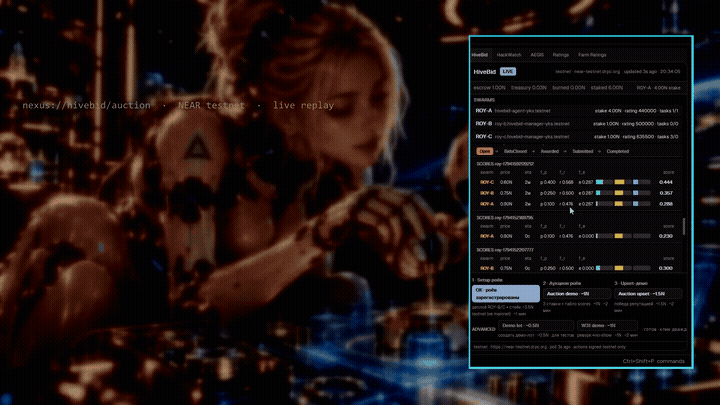
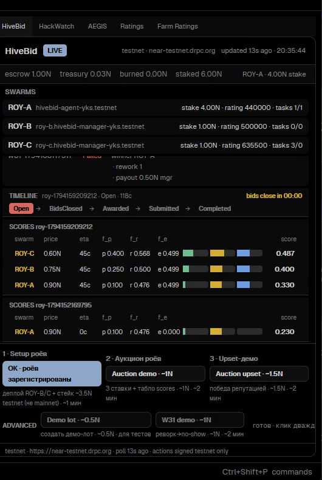
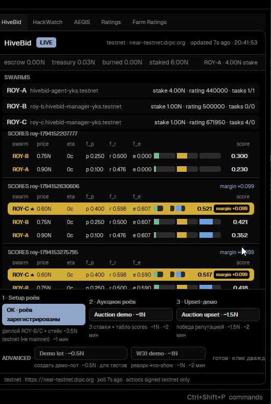

# Demo media

Recorded artifacts from the live testnet auction `roy-1794159209212`
on `hivebid-yksunder.testnet` (NEAR testnet). Full index: `../media.md`.

| Preview | File | What it is |
|---|---|---|
|  | [`nexus-demo-voiced-final.mp4`](nexus-demo-voiced-final.mp4) | Flagship demo — 99 s, 1080p, annotated on-chain numbers + voice-over. |
| — | [`nexus-demo-vertical.mp4`](nexus-demo-vertical.mp4) | Same cut for mobile — 99 s, 1080×1920. |
| — | [`alice-slideshow-v2.mp4`](alice-slideshow-v2.mp4) | Bonus ambience reel — 49 s, silent. |
| — | [`live-bids.gif`](live-bids.gif) | 6 s autoplay loop of live bidding. |
| — | [`poster.jpg`](poster.jpg) | Poster frame. |
|  | [`shots/hivebid-open.png`](shots/hivebid-open.png) | Deck tab during bidding — escrow 1N locked. |
|  | [`shots/hivebid-settled.png`](shots/hivebid-settled.png) | After settle — ROY-C 0.521 / +0.099, escrow 0. |

Watch the flagship video right on GitHub: open
[`nexus-demo-voiced-final.mp4`](nexus-demo-voiced-final.mp4) and use the
built-in player. The interactive page reading the live contract:
<https://ykbojak-alt.github.io/nexus-aios/demo/>
